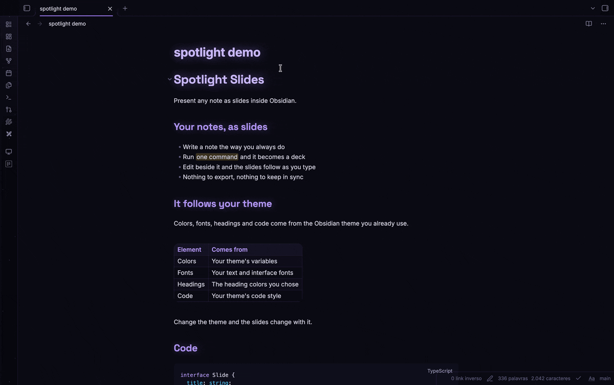
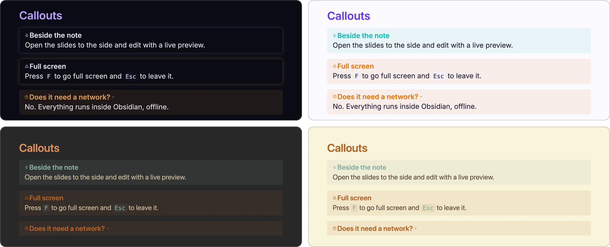
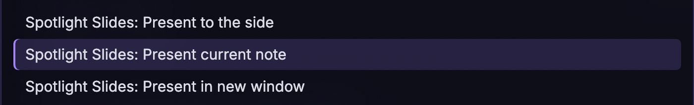
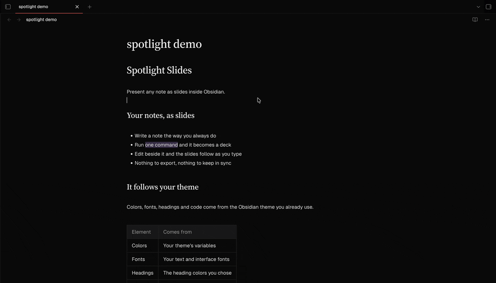
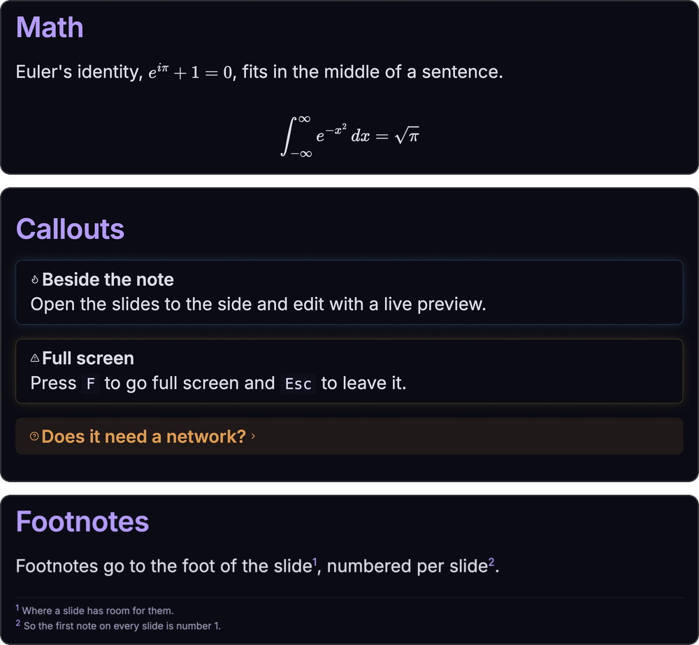

# Spotlight Slides

**English** · [Português (Brasil)](README.pt-BR.md)

Present any note as slides inside Obsidian.



## Features

- **One command, no second file.** Present the note you are reading. There is no separate deck to keep in sync.
- **It looks like your vault.** Slides take their colors, fonts, headings and code style from the Obsidian theme you use, light or dark, and follow it when you change it.
- **Two ways to build a deck.** Let the plugin split a plain note into slides, or write the slides yourself with [Marp](https://marp.app) syntax.
- **Live preview.** Open the slides beside the note and they update as you type, and show the slide that holds your cursor.
- **Obsidian renders what is Obsidian's.** Code blocks, Mermaid, math, callouts, embeds, tasks, links, tags, highlights and footnotes come out the way they do in reading view.
- **Made for presenting.** Keyboard navigation, full screen, a slide counter, a progress bar, and a window of its own for a projector.
- **Private.** It works offline and makes no network requests.



## Installation

Spotlight Slides is for the desktop app, and needs Obsidian 1.5.7 or newer.

### From Community plugins

The plugin is not listed there yet. Once it is, go to **Settings → Community plugins**, select **Browse**, search for "Spotlight Slides", then select **Install** and **Enable**.

### Manually

1. Download `main.js`, `manifest.json` and `styles.css` from the [latest release](https://github.com/the-spanish-guy/obsidian-spotlight-slides/releases).
2. Put the three files in `<your vault>/.obsidian/plugins/spotlight-slides/`.
3. Reload Obsidian, then enable **Spotlight Slides** in **Settings → Community plugins**.

## Usage

Open a note and run one of these from the command palette (`Cmd/Ctrl+P`):

| Command | What it does |
| --- | --- |
| **Present current note** | Opens the slides in a new tab. The ribbon icon does the same. |
| **Present to the side** | Opens the slides to the right of the note, for editing with a live preview that follows your cursor. The keyboard stays with the editor. |
| **Present in new window** | Opens the slides in a window of their own, to drag to a projector or a second screen. |





Beside the note, the slides show the slide that holds the line your cursor is on: click anywhere in the note, or move through it, and that slide comes up. Slides opened in a tab or in a new window do not follow the cursor, so clicking in the note never changes what an audience sees. If the plugin cannot tell for sure where a slide starts, the slides stay where they are.

### Keys and controls

| Key | Action |
| --- | --- |
| `→` `↓` `Page Down` `Space` | Next slide |
| `←` `↑` `Page Up` | Previous slide |
| `Home` / `End` | First / last slide |
| `F` | Toggle full screen (`Esc` leaves it too) |

Move the pointer over the slides to show the previous, next and full screen buttons, with the slide counter. A progress bar runs along the bottom edge.

A slide taller than the screen scrolls with the mouse wheel or the trackpad, and a slim indicator on the right edge shows where you are.

## Building a deck

### Automatic mode

A note without `marp: true` in its front matter is split into slides for you:

- before each section heading, at the shallowest heading level that appears at least twice (if no level repeats, headings do not cut);
- at every horizontal rule (`---`, `***` or `___`).

Code blocks and the note's front matter are never cut. The front matter is not shown.

### Marp mode

Add `marp: true` to the front matter and the note goes to Marp as you wrote it. You decide where the slides break, with `---`, and you can use Marp's directives and image keywords:

```markdown
---
marp: true
paginate: true
---

# First slide

---

## Second slide

![[photo.png|bg left:40%]]

Text beside a background image.
```

The look comes from your Obsidian theme. Directives such as `paginate` and `headingDivider` work. Marp's own themes (`theme: gaia`, `theme: uncover`) switch to a look that does not follow your Obsidian theme, and raw HTML in a note is not rendered.

## What Obsidian renders

| What | You write | Notes |
| --- | --- | --- |
| Code | fenced blocks | Highlighted by Obsidian. Mermaid and other plugins' code blocks work too. |
| Math | `$x^2$` and `$$ ... $$` | Rendered by Obsidian's MathJax. Prices such as `$5 and $10` stay text. |
| Callouts | `> [!note] Title` | Every type, foldable ones (`[!note]-`) and nested ones. |
| Embeds | `![[Note]]`, `![[Note#Heading]]`, `![[Note#^block]]` | Also PDFs, audio and video. |
| Task lists | `- [ ]`, `- [x]`, `- [/]` | Custom statuses look as your theme draws them. Checkboxes are display-only. |
| Links | `[[Note]]`, `[[Note\|alias]]` | Styled as in reading view. Links to missing notes are dimmed. |
| Tags | `#tag`, `#project/sub` | Styled by Obsidian. |
| Highlights | `==text==` | |
| Comments | `%%text%%` | Left out of the slides. |
| Footnotes | `[^1]` with `[^1]: text`, and `^[inline]` | Shown at the foot of each slide, numbered per slide. A reference without a definition stays as text. |

### Images

Images from your vault are found the way Obsidian finds them, or by a path relative to the note. Marp's image keywords go in the alias:

| You write | You get |
| --- | --- |
| `![[photo.png]]` | The image, kept within the slide |
| `![[photo.png\|300]]` | 300 px wide |
| `![[photo.png\|300x200]]` | 300 px wide and 200 px tall |
| `![[photo.png\|bg left:40%]]` | A background filling the left 40% of the slide |
| `` | A Markdown image from the vault |



## Differences and limits

- Slides are 16:9, and break at `---`, `***` and `___`. A horizontal rule cannot be drawn as a line inside a slide.
- Clicking an external link opens it in your browser. Internal links and tags do nothing, so a stray click does not take you out of the presentation.
- Emoji shortcodes such as `:smile:` are not converted. Emoji typed as characters work.
- Marp's built-in themes do not follow your Obsidian theme, and raw HTML is not rendered.
- It does not run on mobile.

Not available yet: exporting to HTML or PDF, and a presenter view with notes and a timer.

## Privacy

Spotlight Slides makes no network requests and has no telemetry or analytics. It reads only the note you present and the files that note refers to in your vault. External links open in your browser only when you select them.

## Credits

Spotlight Slides is built on [Marp Core](https://github.com/marp-team/marp-core) and [Marpit](https://github.com/marp-team/marpit), by the Marp team, under the MIT license.

## Development

You need Node.js 20 or newer.

```bash
npm install
npm run dev      # rebuild on change
npm run build    # type-check and bundle main.js
npm test         # unit tests
npm run lint
```

To try it, link the project folder to `<your vault>/.obsidian/plugins/spotlight-slides` and run `npm run dev`. The `.hotreload` file at the root works with the Hot-Reload plugin.

How it works: the pieces Marp cannot render are cut out of the note and replaced by plain tokens, Marp turns the rest into slides, and Obsidian renders each piece and puts it back.

```text
src/
  main.ts            commands and ribbon icon
  present.ts         where the slides open: tab, side or window
  view.ts            the slide view: keys, links, live updates
  controls.ts        buttons, counter and progress bar
  scroll-indicator.ts
  render/
    slides.ts        the pipeline, in order
    auto.ts          automatic mode: where to cut
    callouts.ts  embeds.ts  footnotes.ts  images.ts  inline.ts  math.ts  tasks.ts
    postprocess.ts   Obsidian renders each piece back into the slides
    theme.ts         the Marp theme that follows the Obsidian theme
  test/              a stand-in for the obsidian module
```

## License

Distributed under the [MIT](LICENSE) license.

Made by [the spanish guy](https://github.com/the-spanish-guy) with 🖤

```
          ／＞　 フ
         | 　_　_|
       ／` ミ__^ノ
      /　　　　 |
     /　 ヽ　　 ﾉ           ╱|、
    /　　 |　|　|         (˚ˎ 。7
／￣|　　 |　|　|          |、˜〵
(￣ヽ＿_  ヽ_)__)         じしˍ,)ノ
＼二)
```
