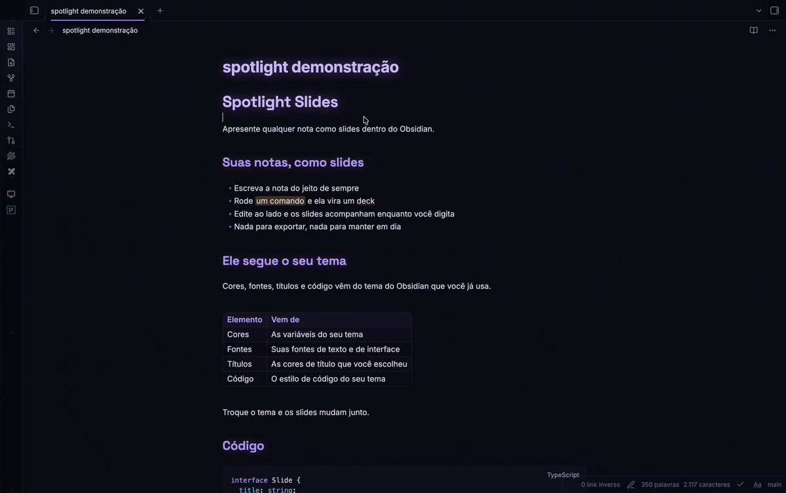
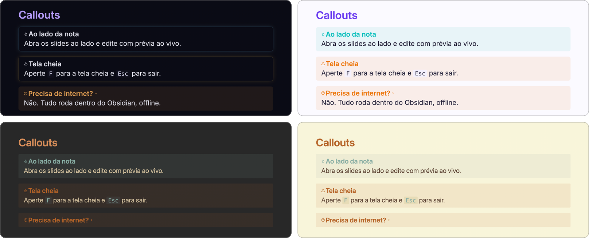
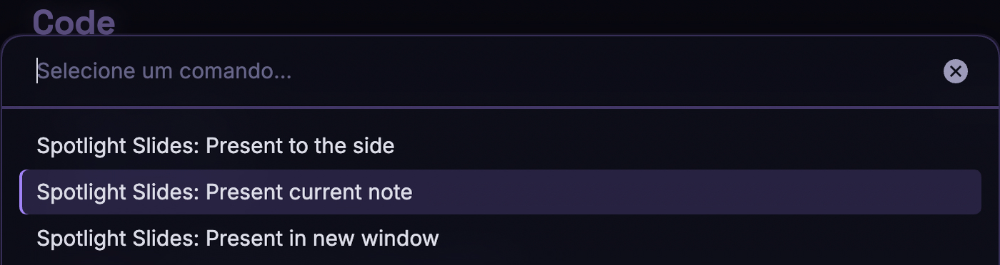
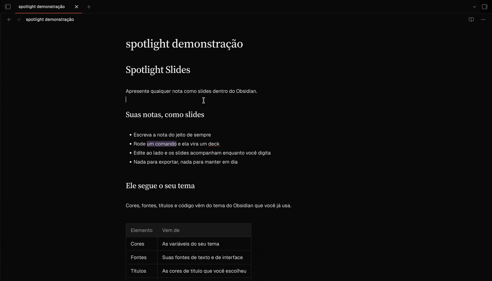
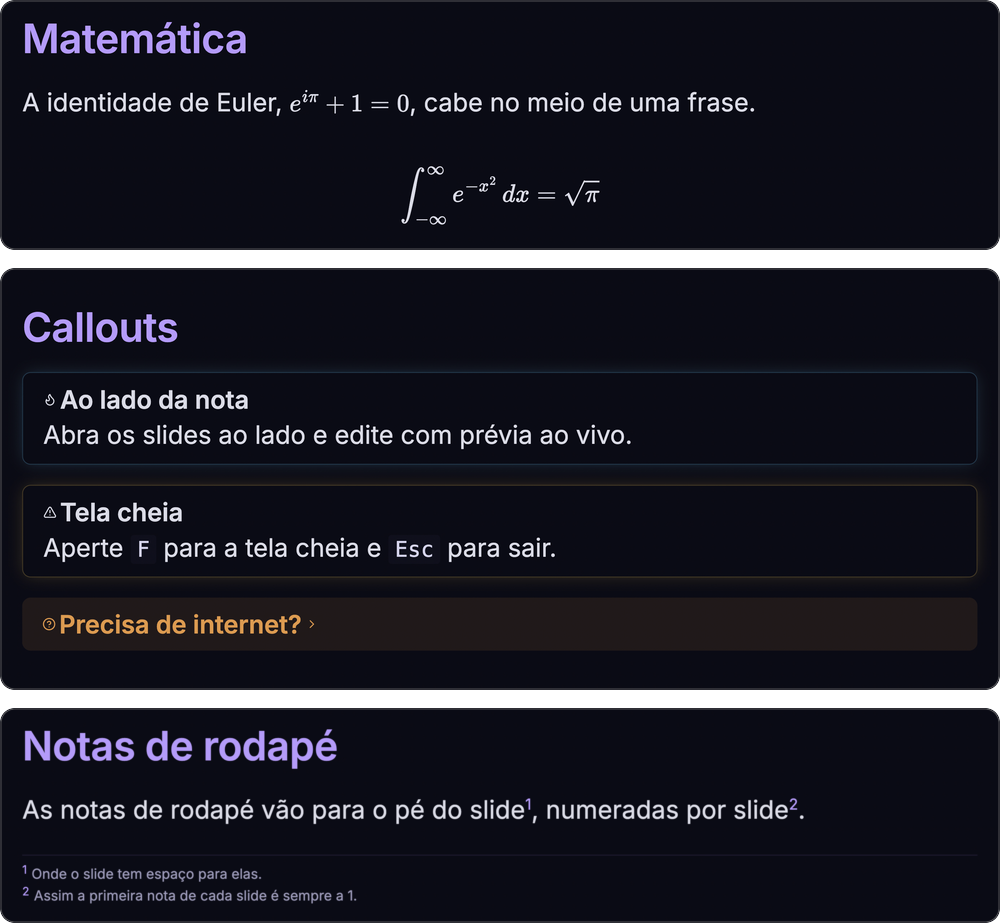

# Spotlight Slides

[English](README.md) · **Português (Brasil)**

Apresente qualquer nota como slides dentro do Obsidian.



## Recursos

- **Um comando, nenhum segundo arquivo.** Apresente a nota que você está lendo. Não há um deck separado para manter em dia.
- **Com a cara do seu cofre.** Os slides usam as cores, as fontes, os títulos e o estilo de código do tema do Obsidian que você usa, claro ou escuro, e acompanham a troca de tema.
- **Duas formas de montar um deck.** Deixe o plugin dividir uma nota comum em slides, ou escreva os slides você mesmo com a sintaxe do [Marp](https://marp.app).
- **Prévia ao vivo.** Abra os slides ao lado da nota e eles se atualizam enquanto você digita, e mostram o slide em que está o seu cursor.
- **O Obsidian renderiza o que é dele.** Blocos de código, Mermaid, matemática, callouts, embeds, tarefas, links, tags, realces e notas de rodapé saem como na visualização de leitura.
- **Feito para apresentar.** Navegação pelo teclado, tela cheia, contador de slides, barra de progresso e uma janela própria para o projetor.
- **Privado.** Funciona offline e não faz nenhuma requisição de rede.



## Instalação

O Spotlight Slides é para o aplicativo de desktop e exige o Obsidian 1.5.7 ou mais novo.

### Pelos plugins da comunidade

O plugin ainda não está listado lá. Quando estiver, vá em **Configurações → Plugins da comunidade**, selecione **Procurar**, busque "Spotlight Slides" e selecione **Instalar** e **Ativar**.

### Manualmente

1. Baixe `main.js`, `manifest.json` e `styles.css` da [última versão](https://github.com/the-spanish-guy/obsidian-spotlight-slides/releases).
2. Coloque os três arquivos em `<seu cofre>/.obsidian/plugins/spotlight-slides/`.
3. Recarregue o Obsidian e ative o **Spotlight Slides** em **Configurações → Plugins da comunidade**.

## Uso

Abra uma nota e rode um destes comandos pela paleta de comandos (`Cmd/Ctrl+P`):

| Comando | O que faz |
| --- | --- |
| **Present current note** | Abre os slides numa nova aba. O ícone da barra lateral faz o mesmo. |
| **Present to the side** | Abre os slides à direita da nota, para editar com uma prévia ao vivo que acompanha o seu cursor. O teclado continua com o editor. |
| **Present in new window** | Abre os slides numa janela própria, para arrastar para um projetor ou um segundo monitor. |





Ao lado da nota, os slides mostram o slide que contém a linha em que o seu cursor está: clique em qualquer ponto da nota, ou mova-se por ela, e esse slide aparece. Os slides abertos numa aba ou numa janela nova não acompanham o cursor, então clicar na nota nunca muda o que uma plateia vê. Se o plugin não consegue saber com certeza onde um slide começa, os slides ficam onde estão.

### Teclas e controles

| Tecla | Ação |
| --- | --- |
| `→` `↓` `Page Down` `Espaço` | Próximo slide |
| `←` `↑` `Page Up` | Slide anterior |
| `Home` / `End` | Primeiro / último slide |
| `F` | Alterna a tela cheia (`Esc` também sai dela) |

Passe o ponteiro sobre os slides para mostrar os botões de anterior, próximo e tela cheia, junto com o contador de slides. Uma barra de progresso corre pela borda de baixo.

Um slide mais alto que a tela rola com a roda do mouse ou o trackpad, e um indicador fino na borda direita mostra onde você está.

## Montando um deck

### Modo automático

Uma nota sem `marp: true` no front matter é dividida em slides para você:

- antes de cada título de seção, no nível de título mais raso que aparece pelo menos duas vezes (se nenhum nível se repete, os títulos não cortam);
- em cada régua horizontal (`---`, `***` ou `___`).

Blocos de código e o front matter da nota nunca são cortados. O front matter não é exibido.

### Modo Marp

Acrescente `marp: true` ao front matter e a nota vai para o Marp do jeito que você escreveu. Você decide onde os slides quebram, com `---`, e pode usar as diretivas e as palavras-chave de imagem do Marp:

```markdown
---
marp: true
paginate: true
---

# Primeiro slide

---

## Segundo slide

![[foto.png|bg left:40%]]

Texto ao lado de uma imagem de fundo.
```

A aparência vem do tema do seu Obsidian. Diretivas como `paginate` e `headingDivider` funcionam. Os temas do próprio Marp (`theme: gaia`, `theme: uncover`) trocam para um visual que não segue o tema do seu Obsidian, e HTML cru numa nota não é renderizado.

## O que o Obsidian renderiza

| O quê | Você escreve | Observações |
| --- | --- | --- |
| Código | blocos delimitados | Realçado pelo Obsidian. Mermaid e blocos de código de outros plugins também funcionam. |
| Matemática | `$x^2$` e `$$ ... $$` | Renderizada pelo MathJax do Obsidian. Preços como `$5 e $10` continuam texto. |
| Callouts | `> [!note] Título` | Todos os tipos, os dobráveis (`[!note]-`) e os aninhados. |
| Embeds | `![[Nota]]`, `![[Nota#Título]]`, `![[Nota#^bloco]]` | Também PDFs, áudio e vídeo. |
| Listas de tarefas | `- [ ]`, `- [x]`, `- [/]` | Status personalizados aparecem como o seu tema os desenha. As caixas são só de exibição. |
| Links | `[[Nota]]`, `[[Nota\|apelido]]` | Estilizados como na visualização de leitura. Links para notas que não existem ficam esmaecidos. |
| Tags | `#tag`, `#projeto/sub` | Estilizadas pelo Obsidian. |
| Realces | `==texto==` | |
| Comentários | `%%texto%%` | Ficam de fora dos slides. |
| Notas de rodapé | `[^1]` com `[^1]: texto`, e `^[em linha]` | Aparecem no pé de cada slide, numeradas por slide. Uma referência sem definição continua como texto. |

### Imagens

As imagens do seu cofre são encontradas do jeito que o Obsidian as encontra, ou por um caminho relativo à nota. As palavras-chave de imagem do Marp vão no apelido:

| Você escreve | Você obtém |
| --- | --- |
| `![[foto.png]]` | A imagem, contida dentro do slide |
| `![[foto.png\|300]]` | 300 px de largura |
| `![[foto.png\|300x200]]` | 300 px de largura e 200 px de altura |
| `![[foto.png\|bg left:40%]]` | Um fundo ocupando os 40% da esquerda do slide |
| `` | Uma imagem Markdown do cofre |



## Diferenças e limites

- Os slides são 16:9 e quebram em `---`, `***` e `___`. Uma régua horizontal não pode ser desenhada como linha dentro de um slide.
- Clicar num link externo o abre no navegador. Links internos e tags não fazem nada, para que um clique sem querer não tire você da apresentação.
- Atalhos de emoji como `:smile:` não são convertidos. Emojis digitados como caracteres funcionam.
- Os temas embutidos do Marp não seguem o tema do seu Obsidian, e o HTML cru não é renderizado.
- Não funciona no celular.

Ainda não disponíveis: exportar para HTML ou PDF, e uma visão do apresentador com anotações e cronômetro.

## Privacidade

O Spotlight Slides não faz requisições de rede e não tem telemetria nem análises. Ele lê apenas a nota que você apresenta e os arquivos a que essa nota se refere no seu cofre. Links externos só abrem no navegador quando você os seleciona.

## Créditos

O Spotlight Slides é construído sobre o [Marp Core](https://github.com/marp-team/marp-core) e o [Marpit](https://github.com/marp-team/marpit), da equipe do Marp, sob a licença MIT.

## Desenvolvimento

Você precisa do Node.js 20 ou mais novo.

```bash
npm install
npm run dev      # recompila a cada mudança
npm run build    # verifica os tipos e gera o main.js
npm test         # testes unitários
npm run lint
```

Para experimentar, ligue a pasta do projeto a `<seu cofre>/.obsidian/plugins/spotlight-slides` e rode `npm run dev`. O arquivo `.hotreload` na raiz funciona com o plugin Hot-Reload.

Como funciona: as partes que o Marp não sabe renderizar são recortadas da nota e trocadas por marcas simples, o Marp transforma o resto em slides, e o Obsidian renderiza cada parte e a devolve ao lugar.

```text
src/
  main.ts            comandos e ícone da barra lateral
  present.ts         onde os slides abrem: aba, ao lado ou janela
  view.ts            a view dos slides: teclas, links, atualização ao vivo
  controls.ts        botões, contador e barra de progresso
  scroll-indicator.ts
  render/
    slides.ts        o fluxo, na ordem
    auto.ts          modo automático: onde cortar
    callouts.ts  embeds.ts  footnotes.ts  images.ts  inline.ts  math.ts  tasks.ts
    postprocess.ts   o Obsidian renderiza cada parte de volta nos slides
    theme.ts         o tema do Marp que segue o tema do Obsidian
  test/              um substituto do módulo obsidian
```

## Licença

Distribuído sob a licença [MIT](LICENSE).

Made by [the spanish guy](https://github.com/the-spanish-guy) with 🖤

```
          ／＞　 フ
         | 　_　_|
       ／` ミ__^ノ
      /　　　　 |
     /　 ヽ　　 ﾉ           ╱|、
    /　　 |　|　|         (˚ˎ 。7
／￣|　　 |　|　|          |、˜〵
(￣ヽ＿_  ヽ_)__)         じしˍ,)ノ
＼二)
```
