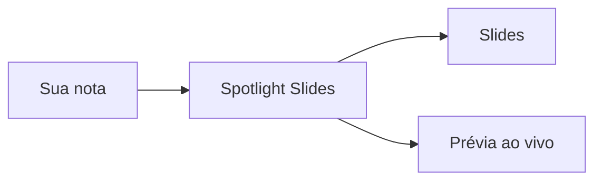

# Spotlight Slides

Apresente qualquer nota como slides dentro do Obsidian.

## Suas notas, como slides

- Escreva a nota do jeito de sempre
- Rode ==um comando== e ela vira um deck
- Edite ao lado e os slides acompanham enquanto você digita
- Nada para exportar, nada para manter em dia

## Ele segue o seu tema

Cores, fontes, títulos e código vêm do tema do Obsidian que você já usa.

| Elemento | Vem de |
| --- | --- |
| Cores | As variáveis do seu tema |
| Fontes | Suas fontes de texto e de interface |
| Títulos | As cores de título que você escolheu |
| Código | O estilo de código do seu tema |

Troque o tema e os slides mudam junto.

## Código

```ts
interface Slide {
  title: string;
  body: string[];
}

function toSlides(note: string): Slide[] {
  return note.split(/^## /m).map(parse);
}
```

## Diagramas



## Matemática

A identidade de Euler, $e^{i\pi} + 1 = 0$, cabe no meio de uma frase.

$$
\int_{-\infty}^{\infty} e^{-x^2}\,dx = \sqrt{\pi}
$$

## Callouts

> [!tip] Ao lado da nota
> Abra os slides ao lado e edite com prévia ao vivo.

> [!warning] Tela cheia
> Aperte `F` para a tela cheia e `Esc` para sair.

> [!question]- Precisa de internet?
> Não. Tudo roda dentro do Obsidian, offline.

## Tarefas

- [x] Escrever a nota
- [x] Apresentá-la
- [ ] Compartilhar com a equipe

## Links, tags e realces

Construído sobre o [Marp](https://marp.app), com o visual do Obsidian. #slides #obsidian

Um trecho também pode ser ==realçado==.

## Notas de rodapé

As notas de rodapé vão para o pé do slide[^1], numeradas por slide[^2].

[^1]: Onde o slide tem espaço para elas.
[^2]: Assim a primeira nota de cada slide é sempre a 1.

## Duas formas de montar um deck

| Modo | Você escreve | Os slides quebram em |
| --- | --- | --- |
| Automático | Qualquer nota | Títulos e réguas |
| Marp | `marp: true` no front matter | Seus próprios `---` |

## Experimente

Rode um destes pela paleta de comandos:

1. **Present current note**
2. **Present to the side**
3. **Present in new window**
