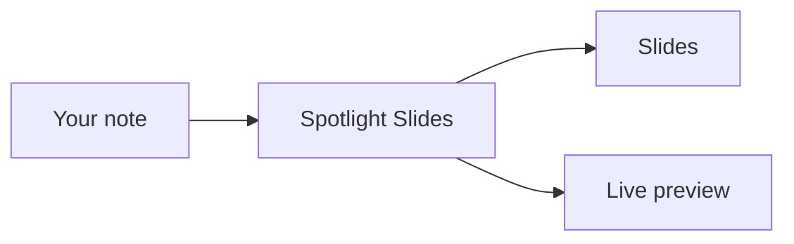

# Spotlight Slides

Present any note as slides inside Obsidian.

## Your notes, as slides

- Write a note the way you always do
- Run ==one command== and it becomes a deck
- Edit beside it and the slides follow as you type
- Nothing to export, nothing to keep in sync

## It follows your theme

Colors, fonts, headings and code come from the Obsidian theme you already use.

| Element | Comes from |
| --- | --- |
| Colors | Your theme's variables |
| Fonts | Your text and interface fonts |
| Headings | The heading colors you chose |
| Code | Your theme's code style |

Change the theme and the slides change with it.

## Code

```ts
interface Slide {
  title: string;
  body: string[];
}

function toSlides(note: string): Slide[] {
  return note.split(/^## /m).map(parse);
}
```

## Diagrams



## Math

Euler's identity, $e^{i\pi} + 1 = 0$, fits in the middle of a sentence.

$$
\int_{-\infty}^{\infty} e^{-x^2}\,dx = \sqrt{\pi}
$$

## Callouts

> [!tip] Beside the note
> Open the slides to the side and edit with a live preview.

> [!warning] Full screen
> Press `F` to go full screen and `Esc` to leave it.

> [!question]- Does it need a network?
> No. Everything runs inside Obsidian, offline.

## Tasks

- [x] Write the note
- [x] Present it
- [ ] Share it with the team

## Links, tags and highlights

Built on [Marp](https://marp.app), styled by Obsidian. #slides #obsidian

A passage can be ==highlighted== too.

## Footnotes

Footnotes go to the foot of the slide[^1], numbered per slide[^2].

[^1]: Where a slide has room for them.
[^2]: So the first note on every slide is number 1.

## Two ways to build a deck

| Mode | You write | Slides break at |
| --- | --- | --- |
| Automatic | Any note | Headings and rules |
| Marp | `marp: true` in the front matter | Your own `---` |

## Try it

Run one of these from the command palette:

1. **Present current note**
2. **Present to the side**
3. **Present in new window**
